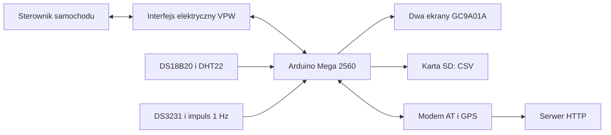

# LS1 Gauge Mega

Projekt wskaźników i rejestratora danych samochodowych na Arduino Mega 2560. Program odpytuje sterownik przez J1850 VPW, wyświetla parametry na dwóch ekranach GC9A01A, zapisuje logi CSV na karcie SD i wysyła paczki binarne przez modem. Odczytuje też temperatury, wilgotność i pozycję GPS.

Gałąź zawiera etap 1 usprawnień dla tego samego sterownika P59: poprawiony odbiór VPW, obsługę modemu bez aktywnego oczekiwania mniejsze zużycie SRAM oraz odczyt 11 kanałów P59 w dwóch pakietach DPID. Bazowy wsad działał na urządzeniu autora. Nową wersję sprawdzono testami hosta i kompilacją Mega 2560; wymaga jeszcze próby na sprzęcie.

## Dokumentacja

- [Dwa pakiety P59](docs/DPID.md): podział kanałów, start, powrót do legacy, diagnostyka i pamięć.

- [Etap 1: zmiany, pamięć i testy](docs/ETAP1.md): wyniki kompilacji, ograniczenia czasowe i próba na urządzeniu.
- [Połączenia i sprzęt](docs/PODLACZENIA.md): piny Mega, wspólne magistrale, przyciski i elementy wymagające potwierdzenia.
- [Biblioteki i uruchomienie](docs/URUCHOMIENIE.md): zależności, konfiguracja, wgranie szkicu, menu i diagnostyka.
- [Działanie i format danych](docs/DZIALANIE.md): odpytywanie VPW, parametry, logi, modem, EEPROM i ograniczenia bieżącego kodu.

## Układ projektu

| Plik lub katalog | Zawartość |
| --- | --- |
| `ls1gauge-mega/ls1gauge-mega.ino` | Inicjalizacja sprzętu i główna pętla |
| `ls1gauge-mega/cmd.h` | Zapytania VPW, dekodowanie odpowiedzi, tablica pomiarów |
| `ls1gauge-mega/display.h`, `obrotomierz.h` | Widoki parametrów i łuki wskaźników |
| `ls1gauge-mega/rtc.h` | RTC, zegar, token i adresy EEPROM |
| `ls1gauge-mega/temp.h` | DS18B20 i DHT22 |
| `ls1gauge-mega/sd.h` | Bufor pomiarów i zapis CSV |
| `ls1gauge-mega/modem.h`, `modem-post.h` | Komendy AT, GPS, kontrola sieci i wysyłka HTTP |
| `ls1gauge-mega/menu.h` | Menu, ustawienia i usypianie ekranów |
| `ls1gauge-mega/drawbmp.h` | Odczyt obrazów BMP z SD |
| `ls1gauge-mega/font.h`, `images.h` | Czcionka i grafika wbudowana |
| `ls1gauge-mega/sscom.ini` | Plik ustawień narzędzia terminalowego; szkic go nie używa |
| `libraries/J1850-VPW-WC/` | Dołączona wersja biblioteki VPW |

## Przepływ danych

Repozytorium zawiera firmware i bibliotekę VPW. Nie zawiera schematu interfejsu samochodowego, projektu zasilania, serwera `logger.php` ani obrazów BMP na kartę SD.
