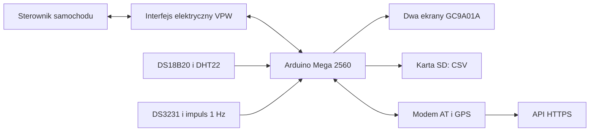

# LS1 Gauge Mega

Projekt wskaźników i rejestratora danych samochodowych na Arduino Mega 2560. Program odpytuje sterownik przez J1850 VPW, wyświetla parametry na dwóch ekranach GC9A01A, zapisuje logi CSV na karcie SD i wysyła ich fragmenty przez LTE/HTTPS do API. Odczytuje też temperatury, wilgotność i pozycję GPS.

Gałąź `codex/vpw-stage1` zawiera obsługę czterech pakietów DPID dla P59: 21 odczytywanych kanałów ECU oraz dodatkowe flagi wydzielane z tych samych bajtów. Wszystkie 27 kanałów, łącznie z czujnikami lokalnymi i GPS, korzystają ze wspólnej struktury `Channel`. Autor potwierdził działanie wcześniejszej obsługi DPID na P59. Bieżący firmware sprawdzono testami hosta i na Mega z modemem: automatyczne wznowienie PWRKEY, NTP, zapis SD i wysyłka HTTPS. Użytkownik potwierdził działanie zegara i przycisków. Próba z 8 listopada nie obejmowała ECM. Poprawka z 9 listopada ogranicza oczekiwanie I²C, zachowuje czas po błędzie RTC i ponawia konfigurację DPID po przejściu na fallback.

## Dokumentacja

- [Test RTC, DPID i zapisu po Battery z 9 listopada](docs/TESTY_RTC-20261109.md): ponad 16 minut na Mega z ECM, SD i LTE; bez resetu Arduino. Zapis trwa przy odbieranym Battery także przy RPM=0. Raport opisuje również nadal występujące błędy I²C i ponowienia LTE.

- [CSV przez LTE, wznowienie modemu i czas RTC](docs/CSV_UPLOAD.md): aktualny tryb wysyłki, konfiguracja SD, PWRKEY na D12 i synchronizacja NTP z korektą powyżej 30 s.

- [Diagnostyka startu modemu](docs/DEBUG_MODEM.md): DEBUG_MODEM, zapis portu COM do pliku, kody zdarzeń i RAM.

- [CSV dla Excela i poprawne daty plików](docs/CSV_EXCEL.md): import, wykres XY, milisekundy i zachowanie starych logów.

- [Szybszy ekran, SD i LTE](docs/SZYBKIE_LOGOWANIE.md): aktualne interwały, CSV, zgodność API i RAM.

- [Cztery DPID i CSV](docs/CSV-P59.md): aktualny zestaw kanałów i kolumn. [Opis wcześniejszego etapu dwóch DPID](docs/DPID.md) dokumentuje rozwój protokołu.

- [Etap 1: zmiany, pamięć i testy](docs/ETAP1.md): wyniki kompilacji, ograniczenia czasowe i próba na urządzeniu.
- [Połączenia i sprzęt](docs/PODLACZENIA.md): piny Mega, wspólne magistrale, przyciski i elementy wymagające potwierdzenia.
- [Biblioteki i uruchomienie](docs/URUCHOMIENIE.md): zależności, konfiguracja, wgranie szkicu, menu i diagnostyka.
- [Działanie i format danych](docs/DZIALANIE.md): odpytywanie VPW, parametry, logi, modem, EEPROM i ograniczenia bieżącego kodu.

## Układ projektu

| Plik lub katalog | Zawartość |
| --- | --- |
| `ls1gauge-mega/ls1gauge-mega.ino` | Inicjalizacja sprzętu i główna pętla |
| `ls1gauge-mega/cmd.h` | Wspólne kanały, zapytania VPW, cztery DPID, walidacja i dekodowanie odpowiedzi |
| `ls1gauge-mega/display.h`, `obrotomierz.h` | Widoki parametrów i łuki wskaźników |
| `ls1gauge-mega/rtc.h` | RTC, parsowanie czasu, strefa Warszawy, zegar i adresy EEPROM |
| `ls1gauge-mega/temp.h` | DS18B20 i DHT22 |
| `ls1gauge-mega/sd.h` | Bufor pomiarów i zapis CSV |
| `ls1gauge-mega/modem.h`, `modem-csv.h` | Komendy AT, GPS, PWRKEY, NTP i wysyłka HTTPS |
| `ls1gauge-mega/csv_*.h` | Format transferu, kolejka SD i konfiguracja TLS |
| `ls1gauge-mega/menu.h` | Menu, ustawienia i usypianie ekranów |
| `ls1gauge-mega/drawbmp.h` | Odczyt obrazów BMP z SD |
| `ls1gauge-mega/font.h`, `images.h` | Czcionka i grafika wbudowana |
| `libraries/J1850-VPW-WC/` | Dołączona wersja biblioteki VPW |

## Przepływ danych

Repozytorium zawiera firmware i bibliotekę VPW. Nie zawiera schematu interfejsu samochodowego, projektu zasilania, kodu serwera HTTPS ani obrazów BMP na kartę SD.

## Organizacja danych

`channels[id]` przechowuje wartość, czas aktualizacji i poprawność pomiaru.
Pierwsze 17 indeksów zachowuje dotychczasową kolejność API. CSV ma osobną kolejność. Kanały ECU
z dalszych indeksów przechowują surowe dane; `raw()` zachowuje pełny zakres
16-bit bez znaku, również dla wtryskiwaczy. Przeliczenia pozostają takie jak
przed refaktoryzacją. Poprawność i czas nie zmieniają zasad zapisu starych kanałów.

`lastDisplayed` przechowuje pamięć odrysowania ekranów, a `gpsHigh` górne słowa
współrzędnych GPS. Definicje zapytań legacy są we Flash, ich czasy wysłania w RAM.
Modem wysyła zapisany CSV z 36 kolumnami, bez drugiego bufora 30 pomiarów w RAM. Stary transport i jego token zostały usunięte.

Obsługa DPID i dodatkowych kanałów jest w `cmd.h`, a wskaźniki w `display.h`.
Nie potrzeba już `extra_channels.h`, `vpw_reply.h`, `vpw_dpid.h` ani
`gauge_indicators.h`. Reguły wcięć i łamania linii zapisano w `.clang-format`.

Testy: `tests/run-host-tests.ps1` (Visual Studio C++) oraz `tests/provision-tests.ps1`. Obejmują VPW/DPID, harmonogram fallback, parser modemu, DEBUG_MODEM, PWRKEY, NTP/RTC, CSV, kolejkę SD, transfer HTTPS i rysowanie interfejsu. Test historycznego protokołu LTE usunięto razem z tym protokołem.
